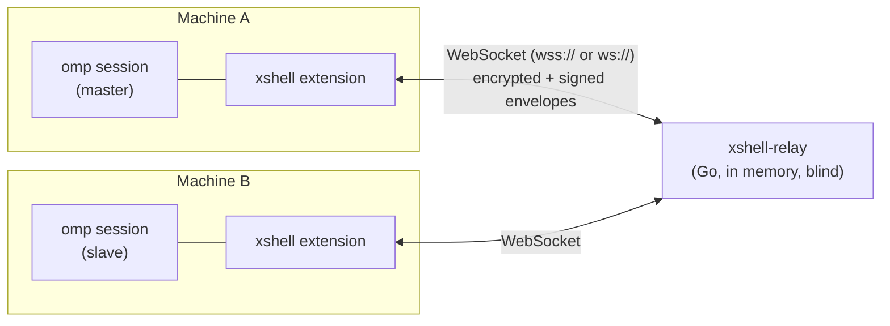

# xshell

Let one omp session ask another omp session — on the same machine or on
another one — to do something, and get the answer back. Sessions talk through a small relay that only forwards
encrypted, signed messages: it never sees ranks, keys, aliases, roles or content.

Typical use: from your laptop's omp session, ask the session running on a prod box "which version of service X is
deployed?" and get the answer as a tool result.

The normative specification is [`doc/SPEC.md`](doc/SPEC.md) (in French). This README is an overview.

## Architecture



| Component | Where | Role |
|---|---|---|
| `extension/` | Bun/TypeScript omp extension | `/xshell` command, model tools, all cryptography, local state and audit |
| `relay/` | Go binary `xshell-relay` | Routes frames between connected sessions; no persistence, no authentication, no access to content |
| `doc/` | Specification | `SPEC.md`, the relay frame JSON Schema and fixed cryptographic test vectors |

### Concepts

- **xshell**: a group of omp sessions, identified by a random `xshell_id` and given a local, human-readable name.
- **member**: one main omp session that joined an xshell. Each session has its own Ed25519 identity; its
  fingerprint (`xs:…`) is its real identifier, its alias (the omp session name by default) is a label.
- **rank**: `master` or `slave`, decided solely by the key a member joined with.
  - A master can send requests, answer questions, invite, rotate keys and destroy the xshell.
  - A slave can only execute requests from masters and ask clarifying questions while doing so. A request signed
    by a slave is always rejected by the receiver.
- **keys**: an xshell has two keys. The *ask* key (master) holds both rank seeds; the *answer* key (slave) holds
  only its own seed. Keys look like `xs2:<relay>:<xshell_id>:<name>:<A|S>:…` and never travel through the relay.

### Security model

- **End to end**: each message is HPKE-encrypted to the recipient's ephemeral X25519 key and signed with the
  sender's Ed25519 key; it carries the sender's certificate, itself signed with the rank seed. Receivers check
  the certificate, the signature, the timestamp window and replay before acting.
- **Blind relay**: certificates published to the relay are encrypted with a key derived from the xshell keys, so
  the relay cannot learn ranks, aliases or roles. It still sees metadata (who talks to whom, when, sizes).
- **No relay authentication**: anyone who can reach the relay can use it to spam an xshell whose id they know, or
  claim another member's fingerprint to divert or drop traffic — never to read or forge messages. Restrict access
  at the network level (localhost, VPN, firewall).
- **Remote content is untrusted data**: answers and questions from other members are injected into the model's
  context as data, never as instructions; omp's own tool approvals stay active.
- **Default policy is `auto`**: a request from a master runs without human confirmation on the receiving side.
  Use `--approve=ask` (or `/xshell policy <name> ask`) to confirm each request.

See [`doc/SPEC.md`](doc/SPEC.md) §2, §4, §5 and §8 for the full rules and accepted risks.

## Installation

Requirements: [mise](https://mise.jdx.dev) (installs Go and Bun from `mise.toml`) and omp.

```sh
mise run build              # build bin/xshell-relay and type-check the extension
mise run extension:install  # link the extension into omp (user scope)
mise run relay:install      # optional: run the relay locally as a launchd agent (macOS), on 127.0.0.1:8080
```

`extension:install` links the sources: after editing them, restart omp. `relay:install` can listen elsewhere with
`XSHELL_LISTEN=host:port mise run relay:install`; logs go to `~/Library/Logs/xshell-relay.log`.

To expose a relay beyond one machine, deploy `relay/` (a `Dockerfile` and a Fly.io `fly.toml` are provided; TLS is
terminated by Fly) or run `bin/xshell-relay` behind a TLS terminator. Keep in mind it is open to anyone who can
reach it.

## Usage

All commands are typed in an omp session. Membership is per omp session: a new session joins nothing until told to.

### Create an xshell

```text
/xshell create infra --relay 127.0.0.1:8080 --notls
```

`--relay` defaults to `$XSHELL_RELAY`. `--notls` connects with `ws://` (needed for a relay without TLS, such as the
local one). The creating session becomes master; its alias is the omp session name unless `--as` is given.

### Bring other sessions in

| Situation | Command |
|---|---|
| Another omp session on the same machine | `/xshell join infra` (the key is read from the local state) |
| A session on another machine | on a master: `/xshell invite infra`; send one of the printed `/xshell join <uuid> --relay … ` lines to the other side, which pastes it; the master confirms the request (declared alias and role) |
| Hand over a key directly | on a master: `/xshell keys infra`, then on the other side `/xshell join xs2:…` |

Invitations are single use, valid 5 minutes, and live only in the memory of the master session that issued them.

### Delegate work

Once a session is master somewhere, its model gets these tools:

| Tool | Purpose |
|---|---|
| `xshell_list` | Members currently reachable (alias, xshell, rank, fingerprint, declared role) |
| `xshell_ask({to, request, wait_s?})` | Send a request and wait for the answer (120 s by default, 600 max); later answers arrive as follow-up messages |
| `xshell_answer({question_id, answer, wait_s?})` | Answer a clarifying question from the member executing your request |
| `xshell_question({question})` | Available to the receiving side while it executes a request: ask the requester for missing information (3 per request) |

`to` accepts `alias`, `alias@<xshell name>` or `alias@xs:<fingerprint prefix>`. The model is told which members exist
through a short section added to its system prompt. In practice you simply ask your session, e.g. *"ask prod-box
which version of the API is deployed"*.

### All commands

| Command | Effect |
|---|---|
| `/xshell create <name> [--relay host[:port]] [--notls] [--as alias] [--approve=ask\|auto] [role…]` | Create an xshell; you are master |
| `/xshell join <key\|uuid\|name> [--relay …] [--notls] [--name local-name] [--as alias] [--approve=…] [role…]` | Join with a key, an invitation UUID (`--relay` required) or the name of an xshell already on this machine |
| `/xshell invite <name>` | Master: two single-use UUIDs (master, slave), valid 5 minutes |
| `/xshell list [name]` | Known members, online state, rank, alias, fingerprint, role |
| `/xshell keys [name]` | Master: ask and answer keys; slave: its answer key |
| `/xshell policy <name> ask\|auto` | Receiving policy of this session for that xshell |
| `/xshell pending` | Requests you sent that still await an answer |
| `/xshell log [name] [-n 20]` | Local audit trail |
| `/xshell leave <name>` | Leave the xshell (this session) |
| `/xshell rotate <name>` | Master: new keys; every member must join again with the new key |
| `/xshell destroy <name>` | Master: after confirmation, members online leave and delete their copy; the local file is removed |

The trailing words after the options are the member's `role`, a free-text, untrusted description shown to others.
Without `--as`, the alias follows the omp session name, and a rename is propagated to the other members.

## Configuration and state

| Variable | Side | Meaning |
|---|---|---|
| `XSHELL_RELAY` | extension | Default relay for `create` and `join <uuid>` |
| `XSHELL_HOME` | extension | State directory, default `~/.omp/xshell` |
| `XSHELL_LISTEN` | relay | Listen address, default `:8080` |

Local state, all files `0600` in `0700` directories:

| Path | Content |
|---|---|
| `~/.omp/xshell/keys/<fp>.key` | Ed25519 identity of one omp session |
| `~/.omp/xshell/shells/<xshell_id>.json` | xshell keys, members of this machine (alias, role, policy, certificate), peer certificate cache, `--notls` choice |
| `~/.omp/xshell/audit/<xshell_id>.jsonl` | Append-only audit trail (requests, answers, invitations, rejections) |

The omp session file only stores which xshells it joined and the pending requests — no secret. The relay keeps
everything in memory; restarting it drops connections and pending invitations, and clients reconnect and
republish on their own.

## Development

```sh
cd extension && bunx tsc --noEmit -p . && bun test   # extension: unit and protocol tests (fake relay)
cd relay && go vet ./... && go test -race ./...      # relay: routing, invitations, limits
bun extension/scripts/gen-vectors.ts                 # regenerate doc/protocol/vectors after a deliberate format change
```

The crypto tests check that the implementation reproduces `doc/protocol/vectors/*.json` byte for byte, so any
accidental change to the key, certificate, envelope or invitation format fails the build.

Layout:

```text
doc/SPEC.md                    normative specification (French)
doc/protocol/                  relay frame JSON Schema, cross-language test vectors
relay/cmd/xshell-relay         relay entry point
relay/internal/{hub,ws,proto,metrics}
extension/src/                 index (omp wiring), session, commands, tools, inbox, transport, crypto, keys, store, audit
extension/scripts/             test vector generator
mise.toml                      build and install tasks
```
